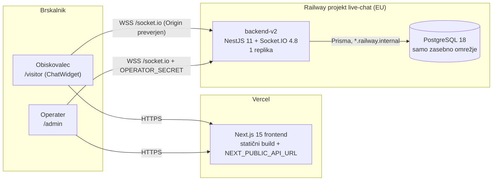

# 1. Arhitektura in namestitev

## Pregled

Aplikacija je monorepo z npm workspaces (`package.json`: `frontend`, `backend`):

| Plast | Tehnologija | Ključne datoteke |
| --- | --- | --- |
| Odjemalec | Next.js 15 (App Router), React 19, Zustand, socket.io-client | `frontend/src/app/*`, `frontend/src/lib/socket.ts`, `frontend/src/store/chatStore.ts` |
| Strežnik | NestJS 11 (Express adapter), Socket.IO gateway | `backend/src/main.ts`, `backend/src/chat.gateway.ts`, `backend/src/chat.service.ts` |
| Podatki | PostgreSQL prek Prisma ORM 6 | `backend/prisma/schema.prisma`, `backend/prisma/migrations/202610230001_init/` |

Frontend ne vsebuje poslovne logike ali skrivnosti. Ob buildu vgradi samo javni `NEXT_PUBLIC_API_URL` (`frontend/src/lib/socket.ts:101`) in neobvezni `NEXT_PUBLIC_SITE_URL` (`frontend/src/app/layout.tsx`). Vsa komunikacija s strežnikom poteka prek **ene Socket.IO povezave**. Edini HTTP endpoint je `GET /` (health: `SELECT 1`, vrne `{"status":"ok"}` ali 503).

Backend je en Nest proces. Ob zagonu (`backend/src/app.module.ts`) preveri okolje: obvezen `DATABASE_URL`, `OPERATOR_SECRET` z vsaj 32 znaki, `FRONTEND_URL` kot seznam točnih izvorov. `main.ts` namesti `OriginAdapter` (CORS, preverjanje Origin, omejitev handshakeov, varnostne glave). Stanje prisotnosti in sobe so v pomnilniku procesa, zato je predpisana **ena replika**.

## Okolja

**Lokalno – Docker Compose** (`compose.yaml`): storitve `postgres` (`postgres:16-alpine`, trajni volumen `chat-postgres`, vrata niso objavljena), enkratna `migrate` (`prisma migrate deploy`), `backend` in `frontend` (obe `node:22-bookworm-slim`, UID 1000). Zagon: `docker compose up --build -d --wait`. CI opravilo `compose-smoke` (`.github/workflows/ci.yml`) isti sklad zgradi in preveri. Za razvoj je na voljo `compose.dev.yaml` (samo PostgreSQL).

**Gostovano (stanje 24. 10. 2026):**

| Komponenta | Kje | Stanje |
| --- | --- | --- |
| Frontend v2 | Vercel projekt `live-chat-support-demo`, predogled veje `release/v2` | Zgrajen (status success), za javnost zaščiten z Vercel Authentication. **Preverjeno:** GitHub deployment status. |
| Produkcijski domeni | `live-chat-support-demo.vercel.app`, `live-chat.tacko.io` | Še vedno **v1** (deployment `dpl_F72Rvy…`). Preklop na v2 je **načrtovan**. |
| Backend v2 | Railway storitev `backend-v2`, `https://backend-v2-production-1ea6.up.railway.app` | Teče; koren `/`, Railpack, ena replika, brez spanja, samodejni deploy zaustavljen. |
| Baza | Railway PostgreSQL 18 v EU, brez javnega TCP proxyja | `DATABASE_URL` je referenca na zasebni naslov. |
| v1 (stari demo) | ločena Railway storitev | Namenoma nespremenjena do preklopa. |

Railway ne uporabi `deploy.startCommand`/`preDeployCommand` iz `railway.json`, zato so build, pre-deploy migracija (`npm run db:migrate -w backend`) in start (`npm start -w backend`) nastavljeni na storitvi (`docs/hosting.md`). Postopek objave v2 je v `docs/release-v2.md`.

## Okoljske spremenljivke backend-v2 (imena, brez vrednosti skrivnosti)

`DATABASE_URL`, `OPERATOR_SECRET`, `FRONTEND_URL` (točni izvori: stari demo, `https://live-chat.tacko.io`, alias predogleda `release/v2`), `CLIENT_IP_HEADER=x-real-ip`, `TRUST_PROXY_HOPS=0`, `HOST`, `NODE_ENV=production`.
