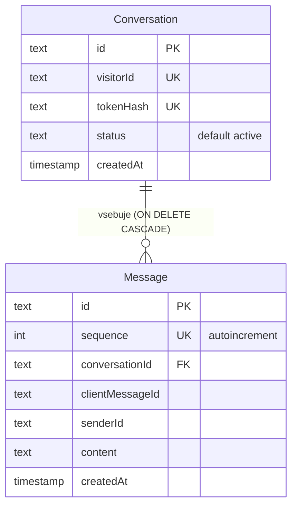

# 2. Podatkovni model

Vir: `backend/prisma/schema.prisma` in edina migracija `backend/prisma/migrations/202610230001_init/migration.sql`. Model ima dve tabeli.

## Conversation (pogovor obiskovalca)

| Polje | Tip (PostgreSQL) | Omejitve | Pomen |
| --- | --- | --- | --- |
| `id` | TEXT | PK, privzeto UUID | Identifikator pogovora (uporablja se tudi kot ime sobe `conv:<id>`). |
| `visitorId` | TEXT | UNIQUE, privzeto UUID | Identiteta obiskovalca, ki jo strežnik vrne odjemalcu. |
| `tokenHash` | TEXT | UNIQUE | SHA-256 zgoščena vrednost naključnega 32-bajtnega žetona; surovi žeton se ne shrani. |
| `status` | TEXT | privzeto `active` | Neaktiven pogovor se ne more prijaviti (`chat.service.ts`). |
| `createdAt` | TIMESTAMP(3) | privzeto `now()` | Osnova za 30-dnevni iztek žetona. |

## Message (sporočilo)

| Polje | Tip | Omejitve | Pomen |
| --- | --- | --- | --- |
| `id` | TEXT | PK, UUID | Strežniški id sporočila. |
| `sequence` | SERIAL (INT) | UNIQUE, autoincrement | Globalno strežniško zaporedje; določa vrstni red prikaza. |
| `conversationId` | TEXT | FK → `Conversation.id`, ON DELETE CASCADE | Pripadnost pogovoru. |
| `clientMessageId` | TEXT | del unikatnega ključa | UUID, ki ga ustvari odjemalec; omogoča idempotentno ponovitev. |
| `senderId` | TEXT | del unikatnega ključa | `visitorId` ali id operaterja; določi ga strežnik iz preverjene povezave. |
| `content` | TEXT | DTO: 1–4000 znakov | Vsebina (React jo izpiše kot besedilo). |
| `createdAt` | TIMESTAMP(3) | privzeto `now()` | Čas shranjevanja. |

## Indeksi

- `Conversation_visitorId_key`, `Conversation_tokenHash_key` (unikatna).
- `Message_sequence_key` (unikaten).
- `Message_conversationId_sequence_idx` — branje zgodovine pogovora po vrstnem redu.
- `Message_conversationId_senderId_clientMessageId_key` (unikaten) — preprečevanje dvojnikov ob ponovnem pošiljanju; ob konfliktu strežnik vrne obstoječe sporočilo brez novega oddajanja.

Operaterji nimajo tabele: obstaja ena skupna skrivnost `OPERATOR_SECRET` (glej poglavje 4 in omejitve).
