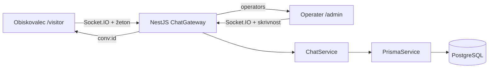

# Arhitektura

Nest AppModule uvozi ConfigModule in registrira gateway ter storitvi. HTTP GET / vrne health procesa (ni preverjanje pripravljenosti baze na vsako zahtevo). Ob zagonu se Prisma poveže z bazo. Gateway izvaja validacijo in avtorizacijo za vsak dogodek. Napake vrnejo splošen error dogodek in negativni ack brez vsebine baze ali skrivnosti.

Obiskovalec je v eni sobi `conv:<conversationId>`, vsi preverjeni operaterji v `operators`. Operater izbira zgodovino in cilj odgovora; za prejem dogodkov ni treba vključiti vseh operaterjev v vsako sobo. Prisotnost velja za povezave trenutnega procesa. Potrebna je ena instanca; več instanc zahteva skupno prisotnost in Socket.IO adapter.
