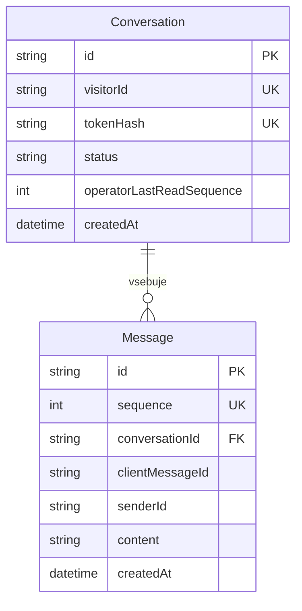

# Podatkovna baza

UUID pogovora ni poverilnica. Strežnik ustvari 256-bitni naključni žeton, v bazi hrani SHA-256. UUID visitorId predstavlja pošiljatelja; operater ima strežniški id `operator`. Message ima unikatno kombinacijo conversationId/senderId/clientMessageId; unikatna omejitev prepreči ponovni zapis. Ob konfliktu create strežnik prebere obstoječo vrstico in je ponovno ne odda. Zaporedje SERIAL določa skupni vrstni red in indeks conversationId/sequence pospeši zgodovino. Presledki v zaporedju so normalni. Odjemalec razvršča po sequence in združuje po id. Čas ustvari baza, ne brskalnik.

Status se začetno nastavi na active; uporabniški tok za zaključevanje pogovora ni implementiran. Migracija je v backend/prisma/migrations; npm run db:migrate -w backend uporablja migrate deploy. Lokalni Compose ima trajni volume; njegovo brisanje uniči lokalne podatke, zato ni del običajnih navodil. Testi morajo uporabljati namensko bazo.
